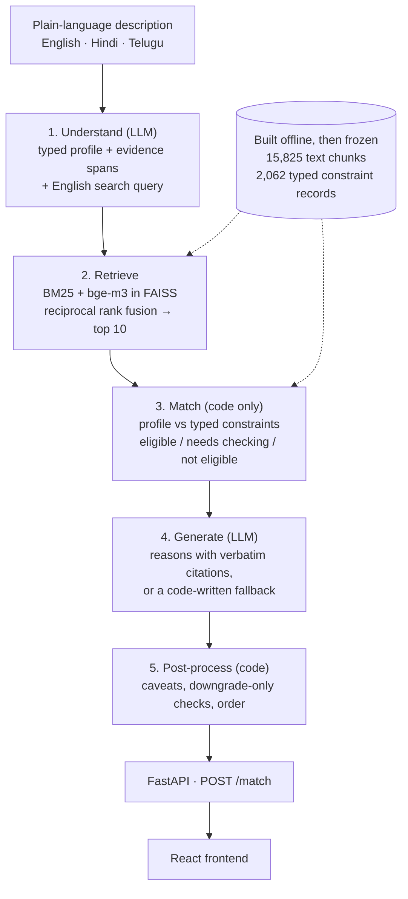

# YojanaMitra

<!-- Live demo: add the link here once the app is deployed. -->

Welfare benefits often go unclaimed by the very people they were written for,
and a common reason is simply that those people never find out they qualify.
YojanaMitra ("scheme friend") lets a person describe their situation in plain
language, in English, Hindi or Telugu, and returns the Indian government
welfare schemes they may qualify for, drawn from 2,066 schemes on the official
myScheme portal. Each result comes with the clause from the scheme's own text
that it rests on, quoted word for word, a checklist of the documents to
gather, and a link to apply on the scheme's official myScheme page.

Every result carries one of three statuses:

- **Eligible:** every condition the system could check passed, including at
  least one about the person and not just their state. Any condition it
  couldn't check is still listed.
- **Needs checking:** nothing rules the scheme out, but something couldn't be
  confirmed from what the person said. The conditions still to confirm are
  listed.
- **Not eligible:** a specific rule in the scheme's text fails against
  something the person stated clearly.

**Status:** an NLP course project. It runs end to end locally. It is not
deployed, and its test-set evaluation is still to come
([Project status](#project-status)).

## The core design principle

**The language model reads and writes. Code decides.**

- **LLMs never decide eligibility.** They do two jobs: understanding (turning
  a description into typed values, each tied to the words it came from) and
  phrasing (explaining a result in the person's language). Every threshold,
  whether an age limit, an income ceiling or a landholding cap, is settled by
  explicit code that compares an extracted value with a typed constraint.
  An LLM output can touch a status in one place only: a relevance flag
  during generation, which can only move a scheme from eligible to needs
  checking.
- **A scheme is ruled out only on hard evidence.** "Not eligible" needs a
  failed condition against a value that is present, extracted with high or
  medium confidence, and unambiguous. Anything uncertain defaults to "needs
  checking": a missing detail, a fuzzy occupation match, a rule the parser
  can't read. Every safety mechanism layered on top of the matcher is
  **downgrade-only**. It can move a scheme from eligible to needs checking,
  never the other way, and none of them can produce "not eligible".

Why: telling someone they don't qualify for money they're entitled to is the
worst error this system can make, because they stop looking.

## How it works

LLM calls sit at the two ends of the pipeline: one reads the description, one
words the answer. The eligibility decision in between is retrieval plus
plain code.



**1. Understand.** One LLM call turns the description into a typed profile
and an English search query. It uses prompt `understand-v4.1` at temperature
0, with Gemini `gemini-3.1-flash-lite` first and Groq `openai/gpt-oss-120b` as
the fallback. The profile has fields such as occupation, state, age, gender,
income, land, caste category, disability percentage, BPL status and
construction-board registration, plus any other facts that could matter.
Every field carries a confidence and the exact span of text it came from, and
code checks the answer before anything uses it:
- each evidence span must occur in the person's text;
- a number must follow from its evidence using only conversions stated there
  (lakh, monthly × 12, hectares);
- age and gender must be the person speaking about themself.

A field that still fails after one retry is dropped, not guessed. For
English, the search query is the person's own text. For Hindi and Telugu it
is a sentence-by-sentence translation that must keep every number and
negation.

**2. Retrieve.** Scheme pages are split into 15,825 chunks, and each query
runs two searches over them:
- **BM25:** keyword search.
- **Dense:** BAAI `bge-m3` embeddings (1,024 dimensions, normalised) in a
  FAISS inner-product index.

The top 50 chunks from each list are fused with reciprocal rank fusion
(k = 60). Chunk scores roll up to schemes through each scheme's best chunk,
and the top 10 schemes go forward.

**3. Match: typed constraints, decided in code.** Each scheme's eligibility
text was extracted offline into a typed constraint record, with the source
clause kept for every condition:
- numeric ranges: age, income, land, school class;
- categorical conditions: gender, caste category, state, residence, marital
  status, BPL, board registration;
- an occupation list;
- residual conditions: anything that fits no typed field, kept as text.

An LLM did the extraction once. The records (2,062 of them) are then frozen,
and no model is involved at query time. Each condition comes out pass, fail
or unknown:
- **Fail** needs a value that is present, high or medium confidence, and
  unambiguous.
- **Fuzzy comparisons** never fail. Occupation is matched by bge-m3
  similarity of at least 0.85, and can only pass or stay unknown.
- **Status:** any failed condition gives not eligible, and any decisive
  unknown gives needs checking. Otherwise the scheme is eligible, as long as
  at least one condition about the person passed.

When missing details block the top results, the matcher picks the single
field most worth asking about, and the person sees it as a clarifying
question.

**4. Generate: cite or abstain.** A second LLM call explains the top 5
results that aren't ruled out, in the person's language. Every citation's
quote must be an exact substring of that scheme's text. Code then checks
three more things:
- the wording agrees with the matcher's status, so a needs-checking scheme
  is never described as one the person qualifies for;
- every number, state and relative mentioned comes from the person's facts
  or the scheme's own text;
- the reason is 1–2 sentences in the person's language.

If a scheme's answer fails after one retry, the model's text is not used.
The scheme gets a reason built in code from its passed conditions, with its
first eligibility clause as the citation. Not-eligible reasons are always
written in code from the failed condition, for example "This scheme's age
limit is 40-79; you said 38".

**5. Post-process.** Code between the pipeline and the API does three things:
- **Conditions to check:** it lists each scheme's unchecked requirements.
  The UI flags any entry that isn't a word-for-word quote of the scheme's
  eligibility text.
- **Stricter-bound downgrade:** a scheme's own text can state a stricter age,
  income, land or disability bound than its typed check covered. If the
  person's answer doesn't settle that bound, the scheme drops from eligible
  to needs checking. For example, a disability pension requires more than
  80% while the typed check used the 40% benchmark.
- **Order:** eligible, then needs checking, then not eligible.

**API and frontend.** FastAPI's `POST /match` takes the description, the
language and an optional answer to a clarifying question. It returns up to 10
schemes, each with:
- status and reason;
- conditions to check;
- the cited clause;
- the documents list;
- the apply link.

It also returns the clarifying question, when one is needed. When the person
names a scheme the corpus doesn't contain, it adds a notice saying so instead
of quietly substituting another. The React frontend shows each result as a
card with "Conditions to check", "See the exact eligibility rule", "Documents
you may need" and "View & apply on myScheme (official site)". Nothing is
stored in the browser.

## Results

The classifier has final results. The matching pipeline has test-set results
from its single scored run; its dev-set numbers are directional only.

### Scheme category classifier

A bge-m3 + logistic-regression classifier reaches **macro-F1 0.742 ± 0.026**
over 15 classes, under stratified 5-fold cross-validation on 2,066 schemes.
It predicts a scheme's myScheme category from its name, description and
benefits text. It was built as the course's supervised-learning component
and stands alone: the matching pipeline doesn't use it. Full report:
[docs/CLASSIFIER.md](docs/CLASSIFIER.md).

Mean ± standard deviation over the five folds:

| Model | Macro-F1 | Weighted-F1 | Accuracy |
|---|---|---|---|
| Majority class | 0.024 ± 0.000 | 0.075 ± 0.001 | 0.213 ± 0.001 |
| Best TF-IDF model: LinearSVC, balanced class weights | 0.688 ± 0.021 | 0.813 ± 0.014 | 0.817 ± 0.013 |
| **bge-m3 embeddings + LogisticRegression, balanced class weights** | **0.742 ± 0.026** | **0.831 ± 0.014** | **0.830 ± 0.012** |

- **Why cross-validation, not a single split.** Four classes have fewer than
  25 schemes, and the smallest (Public Safety, Law & Justice) has 7. A single
  80/20 split would test those classes on one to four schemes each, so their
  scores would rest on a coin flip. With 5 folds every scheme is tested
  exactly once, and the spread across folds shows how stable each score is.
- **Tuning can't see the test fold.** The one tuned hyperparameter (C) is
  chosen by an inner CV within each training fold (nested CV).
- **Near-duplicates don't inflate it.** 85 schemes fall into 34
  near-duplicate groups, mostly the same scheme offered in several states or
  under several names. Group-aware CV keeps each group inside one fold and
  gives 0.742 ± 0.023.

### Label ceiling

**The classifier's ceiling is set by its labels, not by the model.** Its
training labels are silver labels from an LLM. On 100 schemes hand-labelled
blind ([Methodology](#methodology)), the labels and the classifier compare
like this:

| On the 100 hand-labelled schemes | Raw | Reweighted to the corpus |
|---|---:|---:|
| Silver label vs hand label | 0.89 | 0.889 |
| Classifier vs hand label | 0.82 | 0.840 |
| Classifier vs silver label | 0.87 | 0.903 |

- **The classifier learned the labeller's mistakes.** On 8 schemes both the
  classifier and the silver label were wrong, and in all 8 the classifier
  made the same mistake as the silver label.
- **So 0.742 measures agreement with the labelling model.** It can't be read
  as accuracy on the true myScheme taxonomy.
- **The 0.89 is not an independent figure.** It is a re-score after a prompt
  fix designed from these same 100 schemes. Before the fix it was 0.83 (0.821
  reweighted).
- **The uncertainty is wide.** With n = 100, each figure is uncertain by
  about ±7 points.

### Test-set evaluation

The test split has 82 gold rows: 43 positive, 23 exclusion, 12 clarify and 4
no-match. The 2 `skip_scoring` rows are not among them. It was scored once,
on 2026-10-29, against the frozen system at commit `6b1ac224`.
- **Full results:** tables, per-language breakdowns and the run's provenance
  are in [docs/TEST_RESULTS.md](docs/TEST_RESULTS.md).
- **The † mark:** figures marked † were computed from the per-row records,
  not read from a result file's metrics block.
- **Row–scheme pairs:** some rows list more than one scheme, so the
  end-to-end figures count pairs: 52 over the 43 positive rows, and 24 over
  the 23 exclusion rows.

**The safety results held on unseen data.**
- **No false exclusions.** 0 of 52 expected schemes were ruled out, and 0 of
  24 excluded schemes were marked eligible.
- **No hallucinated eligibility.** 0 of the 820 returned reasons claimed an
  eligibility the final status didn't give. Validation caught and retried 1
  such claim before it reached the output.
- **Citations.** 668 of 677 first-attempt citations were exact quotes
  (0.9867), and all 1,153 final citations were valid.

**End to end, 0.3654 of expected schemes (19 of 52) were in the top 10 and
not ruled out.** That figure is bounded by retrieval, not by matching:
- 33 of 52 expected schemes never reached the top 10;
- the matcher made no incorrect calls: it ruled out none of the expected
  schemes and marked none of the excluded ones eligible.

Also measured:
- **Correctly ruled out:** 0.1667 of excluded schemes (4 of 24). The other 20
  stayed at needs checking, because without hard evidence a scheme isn't
  ruled out.
- **Fallback:** 10 of 317 explained schemes (0.0315) got the code-written
  reason, because the LLM gave no valid answer after the retry.
- **No-match rows:** none of the 4 had a reason naming the invented scheme.

**Retrieval on the rewritten query** (43 positive rows):

| Mode | Recall@5 | Recall@10 | MRR@10 |
|---|---:|---:|---:|
| BM25 (keyword baseline) | 0.2326 | 0.4186 | 0.2172 |
| Dense (bge-m3) | **0.3953** | **0.4651** | **0.3491** |
| Hybrid (RRF), deployed | 0.3488 | 0.3953 | 0.2667 |

**One table is enough.** For all 72 English rows the rewritten query is
identical to the description †, so raw and rewritten queries differ only on 9
Hindi and Telugu rows. The table shows the rewritten queries, which the
pipeline uses. The raw-query figures are in TEST_RESULTS.md.

**Dense outperformed hybrid on every positive metric, for raw and rewritten
queries alike. Hybrid is the deployed mode.**
- **Why hybrid:** it was chosen before the test run, on principle, because
  dev, with 10 positive rows, could not separate the two (see the dev table
  below).
- **What test shows:** at 43 positive rows, the measurement favours dense.
- **Hybrid's one advantage** was on exclusion rows: an excluded scheme
  reached its top 10 on 9 of 23 rows, against dense's 10 †.
- **The deployed mode is unchanged.** Changing it now and re-scoring would
  turn the test split into a second dev set.

### Development-set results (directional only)

**These numbers steered development, so they are not an estimate of
performance.** The dev split has 20 rows, 10 of them positive, so each
positive dev row is worth 0.10 of recall.

**Retrieval on the raw description**, from
[`dev_20260922-130736.json`](data/eval/dev_20260922-130736.json):

| Mode | Recall@5 | Recall@10 | MRR@10 |
|---|---:|---:|---:|
| BM25 (keyword baseline) | 0.10 | 0.30 | 0.059 |
| Dense (bge-m3) | 0.40 | 0.60 | 0.267 |
| Hybrid (RRF) | 0.40 | 0.50 | 0.216 |

**The frozen pipeline**, from
[`e2e_dev_20260922-191512.json`](data/eval/e2e_dev_20260922-191512.json),
uses the `understand-v4.1` rewrite with hybrid search:
- **Retrieval:** the expected scheme was in the top 10 on 6 of 10 positive
  rows (recall@10 0.60). MRR wasn't computed for this configuration.
- **Positive rows:** the expected scheme was marked not eligible on 0 of 10,
  eligible on 2 and needs checking on 8.
- **Exclusion rows:** the excluded scheme was shown as eligible on 0 of 6,
  correctly ruled out on 2, and left at needs checking on 4. That is the
  trade-off the design accepts: without evidence hard enough to rule a
  scheme out, it stays at needs checking.
- **Profile extraction:**
  - state 11 of 11, age 5 of 6, occupation 9 of 12 (approximate match);
  - false fills: occupation on 1 of 8 rows that gave none, income on 1 of 20.

**Generation**, from
[`generate_dev_20260922-202840.json`](data/eval/generate_dev_20260922-202840.json):
- 0 explanations claimed an eligibility the matcher didn't give, out of 84
  explained schemes.
- 187 of 188 first-attempt citations were exact quotes, and all 243 final
  citations were.
- 1 scheme fell back to the code-written reason.

This run predates the post-processing layer, so it doesn't describe exactly
what `/match` returns today.

## Methodology

**The evaluation was fixed before any system output was scored, and built so
it can't quietly flatter the system.**

- **The gold set is frozen.** It has 104 rows: 92 English, 6 Hindi and 6
  Telugu, typed as positive (54), exclusion (30), clarify (15) and no-match
  (5).
  - **Verification:** the 63 expected row–scheme pairs were checked against
    a verbatim clause of each scheme's eligibility text, and every
    exclusion's excluding clause was confirmed in the excluded scheme's text.
    The checks were AI-assisted, and disagreements were adjudicated by hand.
  - **Invented names:** the no-match rows name invented schemes, confirmed
    absent from the corpus.
  - **Corrections:** the set was frozen on 2026-09-21. Every correction is in
    a dated table, and all of them were made before any output was scored.
    See [data/gold/README.md](data/gold/README.md).
- **The test set is scored once.** Dev has 20 rows and test 82, stratified
  by type with a fixed seed.
  - A seeded swap puts one Telugu positive row in dev. That rule was settled
    before any evaluation read the split.
  - The evaluation scripts refuse the test split without `--final`.
  - Components were frozen and tagged after their final dev runs. Every later
    change is logged in
    [docs/CHANGES_SINCE_FREEZE.md](docs/CHANGES_SINCE_FREEZE.md), with its
    evidence and whether it can change a status.
- **Silver labels were verified blind, in two rounds.** The labelling script
  writes a sheet for the human with each scheme's name, level, state,
  description and benefits, and an empty category column. The model's
  predictions go to a separate file that isn't opened until the hand labels
  are complete.
  - **Round 1:** 30 schemes. Agreement with the hand labels is 0.80 for the
    classifier and 0.90 for the current silver labels.
  - **Round 2:** 100 new schemes, drawn only from the
    `gemini-3.1-flash-lite` labels. They were stratified by predicted
    category with a floor per class, then reweighted to the corpus.
- **Round 2 found a self-contradictory labelling prompt, and it was fixed.**
  - **The contradiction:** the spec said to classify by the benefit first,
    then made an exception preferring Social Welfare for marginalised groups,
    while a later rule sent scholarships to Education. Nothing said which
    rule wins.
  - **The evidence:** 11 of the 17 round-2 disagreements were schemes the
    model had put in Social Welfare, 9 of them group-identity overrides of an
    education, business or agricultural benefit. No disagreement ran the
    other way.
  - **The fix:** the prompt now states the precedence: group identity selects
    Social Welfare only when the benefit itself is social protection. All 634
    schemes labelled Social Welfare were relabelled, and 246 labels changed.
  - **The redistribution:** Social Welfare went from 634 schemes to 388.
    Education gained 75, Business 56, Health 28, Agriculture 26, Skills 22,
    and the other classes 39 between them.
- **Zero hallucinated eligibility is enforced by a validator, not hoped
  for.** Code checks every generated reason against the matcher's status and
  rejects unhedged eligibility claims ("you are eligible") on a scheme the
  matcher didn't mark eligible. A failing answer is retried once, then
  replaced with a code-written reason. On dev the final count was 0, and the
  validator never had to fire. The claim check matches known phrasings, so it
  is a guard on wording, not a proof.
- **Two gold rows are excluded because the source data contradicts itself.**
  Both stay in the file, marked `skip_scoring`, and scoring reports how many
  rows it skipped.
  - **gold_069 (`pmmvy`):** the eligibility text covers the first live birth
    only, while the description and benefits pay ₹6,000 for a second child
    who is a girl.
  - **gold_032 (`pmsscsn`):** the name says Scheduled Caste, but the
    eligibility text says Scheduled Tribe of Nagaland. The raw page has the
    same inconsistency.

## Honest limitations

**Know these before trusting a result.** As in
[Test-set evaluation](#test-set-evaluation), † marks a figure computed from
the per-row records rather than read from a metrics block.

- **The corpus is stale.** The scheme data is from the myScheme portal as of
  28 March 2024. Schemes may have changed, closed or been added since, so
  always confirm on the official page.
- **The silver labels are roughly 82–89% accurate.**
  - **Before the prompt fix**, blind agreement with hand labels was 83%
    (82% reweighted).
  - **The 89% after it** is a re-score of the same 100 schemes whose
    disagreements drove the fix, so it isn't independent.
  - **Not hand-checked:** none of the 327 Groq-labelled or 77
    gemini-3.6-flash-labelled schemes was in round 2.
- **Rare classes are effectively unlearnable at this corpus size.** Public
  Safety, Law & Justice has 7 of 2,066 schemes, so each test fold holds one or
  two of them, and it scores F1 0.18. Its schemes read like Social Welfare,
  which has 388. Only more schemes would fix it.
- **Expected-scheme lists aren't exhaustive.** A gold row names the schemes a
  description should surface, not every scheme that could fit. For example,
  gold_090's notes say three more schemes would also fit once age is known.
  A returned scheme that isn't on the list isn't necessarily wrong, so any
  precision computed against the lists is a lower bound. The evaluation
  reports recall, not precision.
- **Excluded schemes often reach the top 10, but none is shown as
  eligible.**
  - **Retrieval stage:** on the 23 exclusion rows, the false-inclusion rate
    (an excluded scheme in the top 10) is 0.3913 with hybrid and 0.4348 with
    dense. Retrieval isn't meant to exclude anyone; the matcher decides
    afterwards.
  - **Matching stage:** each excluded scheme was also matched directly, and
    none of the 24 was marked eligible.
  - **What the person sees:** of hybrid's 9 inclusions †, the matcher ruled
    out 3 and left 6 at needs checking, so those 6 reach the person as
    schemes to check.
  - **How they got in:** in 3 of the 9, the scheme was pulled in by its own
    exclusions clause, the text that rules the person out.
- **Telugu is barely measured, and what was measured is weak.**
  - **Tiny n:** the test split has 4 Telugu positive rows and no Telugu
    exclusion rows, so one row moves a Telugu rate by 0.25. These figures
    say "it failed on most of the few rows tested"; they don't measure
    Telugu performance. Hindi, with 3 positive rows, is in the same position.
  - **Retrieval:** the best recall@10 in any mode was 0.25, with the
    rewritten query; only gold_043's scheme was found. On the raw Telugu
    description, every mode scored 0. Translation isn't the whole problem:
    two Telugu rows were rewritten into clean English, and retrieval still
    missed.
  - **Extraction:** all three Telugu extraction misses are one row, gold_071.
    Understand returned an invalid result there, and the profile came back
    empty.
  - **Dev:** the only Telugu dev row (gold_065) also misses retrieval with
    the frozen pipeline, and loses the stated age.
- **Extraction did not improve on test, even though the overall figure
  rose.**
  - **The headline figures:** field accuracy was 0.904 on test against 0.879
    on dev. That is not a gain.
  - **Why it isn't a gain:** dev had no gold income or caste values, and on
    test those two fields were 39 of 39.
  - **Like for like:** on the five fields both splits scored, test is
    0.8768 † and dev 0.8788.
- **The LLM is on the critical path.** Understanding needs an LLM, and the
  providers are free tier: about 20 Gemini requests and 200,000 Groq tokens
  per key per day.
  - **When no provider answers**, the API still responds, but degraded.
    Retrieval runs on the raw text, which isn't translated for Hindi and
    Telugu. No profile is extracted, so every result comes back as needs
    checking, with a code-written template reason and no clarifying
    question.
  - **One fatal provider error** disables that provider until restart.
  - **Rate-limit waits** can outlast the frontend's 90 s timeout.
- **Constraint extraction has known gaps.**
  - **Missing records:** 17 schemes have extraction-failed stand-ins and 4
    have no record. Those are always needs checking.
  - **Multi-branch error mode:** when a scheme lists several eligible groups,
    extraction can apply one group's condition to all of them. 396 records
    carry the flag for this.
- **Input styles are untested.** Every English gold description uses a
  first-person word, so terse input like "farmer, AP, 2 acres" hasn't been
  evaluated. An age stated without a first-person word can be dropped.

## Running it locally

**Once the data and keys are in place, it's two commands.**

Setup:
- **Python 3.13:** `pip install -r backend/requirements.txt`.
- **Node.js and npm:** run `npm install` in `frontend/`.
- **Repo-root `.env`:** copy `.env.example` and fill in the Gemini and/or
  Groq API keys.
- **`frontend/.env`:** must contain `VITE_API_BASE_URL=http://localhost:8000`.
  It is gitignored, so a fresh checkout has to create it. Vite reads it at
  start-up.
- **Data:** `data/interim`, `data/index` and `data/cache` are gitignored.
  `python scripts/restore_data_backup.py` restores them from a private
  Hugging Face dataset repo, which needs access. It also rebuilds
  `data/processed/chunks.jsonl`, which the API checks against the index
  before it starts.

Then, from the repo root, run each command in its own terminal:

```bash
cd backend && uvicorn app.main:app --port 8000
cd frontend && npm run dev
```

Open **http://localhost:8080**.

- **Port 8080 and `strictPort`:** the API accepts browser requests only from
  `ALLOWED_ORIGINS`, which defaults to exactly `http://localhost:8080`. The
  dev server runs with `strictPort`, so a busy port fails at start-up instead
  of drifting to 8081, where every request would be rejected. Use
  `localhost`, not `127.0.0.1`.
- **The first query is slow:** 18–25 s of one-time warm-up after start-up.
  After that, a new description takes about 15–20 s (three LLM calls) and a
  cached one about 2 s.
- **Health check:** `curl http://localhost:8000/health` shows each LLM
  provider's key state.

The classifier runs separately with `python scripts/classifier/run_all.py`,
which takes about 5 minutes on an 8-core laptop.

## Tech stack

- **Language models:** Gemini `gemini-3.1-flash-lite` first, Groq
  `openai/gpt-oss-120b` as fallback, at temperature 0, through the
  `google-genai` and `groq` SDKs with key rotation.
- **Retrieval:** BAAI `bge-m3` through sentence-transformers on PyTorch,
  FAISS (`IndexFlatIP`), and `rank_bm25`, fused with reciprocal rank fusion.
- **Matching and post-processing:** plain Python with no LLM calls. bge-m3
  similarity is used only for the fuzzy comparisons.
- **API:** FastAPI on uvicorn, with dependencies pinned in
  `backend/requirements.txt`.
- **Frontend:** React, TypeScript, TanStack Start, Tailwind CSS and Vite,
  scaffolded with Lovable.
- **Classifier:** scikit-learn (TF-IDF, LogisticRegression, LinearSVC,
  RandomForest), SciPy and matplotlib.
- **Data:** myScheme scheme pages from the public Hugging Face dataset
  `shrijayan/gov_myscheme`.

## Project status

**YojanaMitra was built as an NLP course project. It runs end to end on a
laptop, and it is not deployed or production-ready.**

Complete:
- **Corpus and labels:** 2,066 scheme records parsed, with silver category
  labels and typed constraint records.
- **Evaluation:** the frozen gold set and the evaluation scripts.
- **Pipeline:** understanding, hybrid retrieval, matching, generation and
  post-processing, all frozen.
- **App:** the FastAPI service and the React frontend, wired together and
  run locally.
- **Classifier:** the category classifier and its evaluation.
- **Test-set evaluation:** the single scored run on the 82 test rows, on
  2026-10-29. See [Test-set evaluation](#test-set-evaluation).

In progress:
- **Deployment:** the app is not deployed.

## Repository layout

```
backend/app/        understand.py, retrieval.py, matcher.py, generate.py,
                    postprocess.py, main.py (the FastAPI app)
frontend/           React + TypeScript UI
scripts/            PDF parsing, category labelling, constraint extraction,
                    chunking and index build, evaluation, data restore
scripts/classifier/ the scheme category classifier
data/gold/          the gold evaluation set and its README
data/eval/          evaluation outputs: dev runs, the test run, classifier results
docs/               CLASSIFIER.md, CHANGES_SINCE_FREEZE.md, HANDOFF.md,
                    TEST_RESULTS.md
```

## Data source

Scheme information comes from the myScheme portal of the Government of India,
via the public Hugging Face dataset `shrijayan/gov_myscheme`. YojanaMitra is
not an official government service. Treat its results as a starting point,
and confirm eligibility on the scheme's official page before applying.
